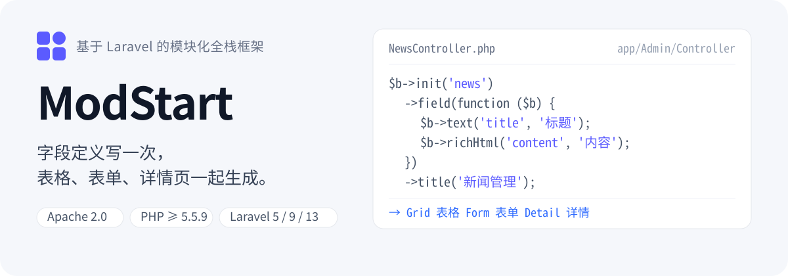
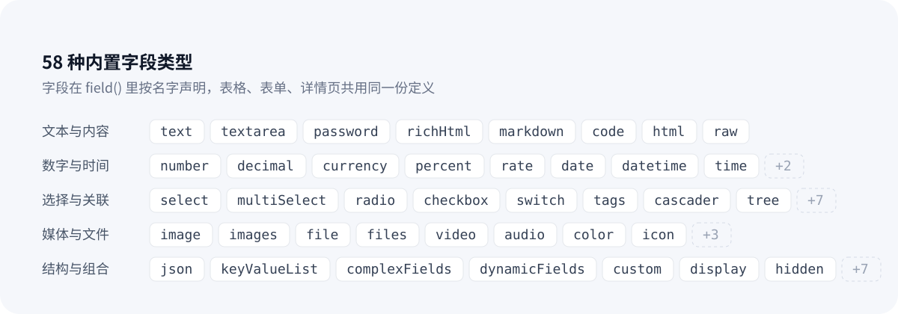
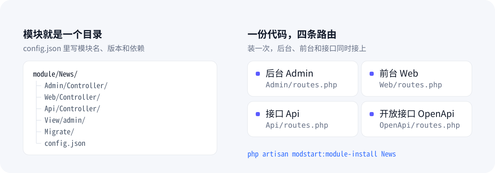

<p align="center">
  
</p>

ModStart 是一个基于 Laravel 的全栈 Web 开发框架。后台的数据表格、数据表单和详情页从同一份字段定义生成；功能以模块目录的形式装卸，装上一个模块，后台页面、前台页面和接口就一起接进路由了。代码开源（Apache 2.0），不加密，可商用。

## 一份字段定义，三套界面

后台 Controller 里写一次 `crud()`：

```php
use ModStart\Admin\Concern\HasAdminQuickCRUD;
use ModStart\Admin\Layout\AdminCRUDBuilder;
use ModStart\Grid\GridFilter;

class NewsController extends Controller
{
    use HasAdminQuickCRUD;

    protected function crud(AdminCRUDBuilder $builder)
    {
        $builder->init('news')
            ->field(function ($builder) {
                $builder->id('id', 'ID');
                $builder->text('title', '标题');
                $builder->richHtml('content', '内容');
                $builder->display('created_at', '创建时间');
            })
            ->gridFilter(function (GridFilter $filter) {
                $filter->eq('id', 'ID');
                $filter->like('title', '标题');
            })
            ->title('新闻管理');
    }
}
```

`grid()`、`form()`、`detail()` 三个入口都读这份字段列表：表格带筛选、排序、批量操作和导出，表单带校验、上传和字段联动，详情页按同样的顺序排布只读字段。要加字段，改的还是这一段。

## 字段类型

<p align="center">
  
</p>

58 个字段类都在 [`src/Field`](https://github.com/modstart-lib/modstart/tree/master/src/Field)，另有 7 个布局组件（`layoutGrid`、`layoutTab`、`layoutTable` 等）用来拼表单结构。文本、图片、文件、富文本、代码、颜色、级联、树、关联模型、JSON、键值对都在里面，不够用时继承 `AbstractField` 自己加一个。

## 模块

<p align="center">
  
</p>

模块是 `module/` 下的一个目录。框架按目录名把 `Admin/routes.php`、`Web/routes.php`、`Api/routes.php`、`OpenApi/routes.php` 注册进对应路由，一份业务代码同时给后台、前台和接口用；数据表迁移放在 `Migrate/`，随模块安装执行。

```bash
php artisan modstart:module-install News     # 安装模块并执行迁移
php artisan modstart:module-list             # 列出本地模块
php artisan modstart:module-disable News     # 停用，不删文件
php artisan modstart:module-uninstall News   # 卸载
```

现成模块从[模块市场](https://modstart.com/store)下载，CMS、商城、题库、AI 问答等装完即用。

## 已经做好的部分

- 文件上传默认上限 1GB（`config/data.php`），图片可在前端压缩后再传
- 登录和后台表单接了验证码，富文本经 HTMLPurifier 过滤
- 打开 `TRACK_PERFORMANCE` 后，慢 SQL 和超过 5 秒的请求会写进日志
- 中英文语言包在 `lang/`，加语言按同样目录扩展
- 后台样式适配了 Element UI、iView、LAYUI 三套主题

## 环境要求

| 项目 | 要求 |
| --- | --- |
| Laravel | 5.1 / 9 / 13，三个版本各有独立仓库 |
| PHP | 5.5.9 起（`composer.json` 约束）；Laravel 9 版用 8.0/8.1，Laravel 13 版用 8.5 |
| 数据库 | MySQL |
| PHP 扩展 | json、curl、gd、zip、iconv、fileinfo |
| 缓存 | Redis 可选，登录 Session 和缓存用得上 |

## 安装

这个仓库是框架核心包（`modstart/modstart`）。要跑起一个完整应用，从对应版本的纯净框架源码起步：

| 版本 | 仓库 |
| --- | --- |
| Laravel 5.1 | [open-tecmz/modstart-laravel5](https://github.com/open-tecmz/modstart-laravel5) |
| Laravel 9 | [open-tecmz/modstart-laravel9](https://github.com/open-tecmz/modstart-laravel9) |
| Laravel 13 | [open-tecmz/modstart-laravel13](https://github.com/open-tecmz/modstart-laravel13) |

克隆后填好 `.env`（`APP_KEY`、`DB_HOST`、`DB_DATABASE`、`DB_USERNAME`、`DB_PASSWORD`、`ADMIN_PATH`），然后执行：

```bash
php artisan modstart:init
```

它会跑迁移、安装模块、建后台账号，用户名和密码在执行时输入。也可以分步执行：

```bash
php artisan migrate
php artisan modstart:module-install-all
```

后台默认在 `/admin/`，路径由 `ADMIN_PATH` 决定。

## 文档与资源

- 开发文档：[modstart.com/doc](https://modstart.com/doc)
- 演示站：[demo.modstart.com](https://demo.modstart.com)
- 模块市场：[modstart.com/store](https://modstart.com/store)
- AI 辅助编程：[modstart.com/ai_develop](https://modstart.com/ai_develop)（网页服务，描述需求后生成模块代码）
- 本项目：[github.com/modstart-lib/modstart](https://github.com/modstart-lib/modstart)

## 交流群

> 添加时请备注 ModStart

<table width="100%">
    <thead>
        <tr>
            <th width="50%">微信交流群</th>
            <th>QQ 交流群</th>
        </tr>
    </thead>
    <tbody>
        <tr>
            <td>
                
            </td>
            <td>
                
            </td>
        </tr>
    </tbody>
</table>

## License

Apache 2.0
